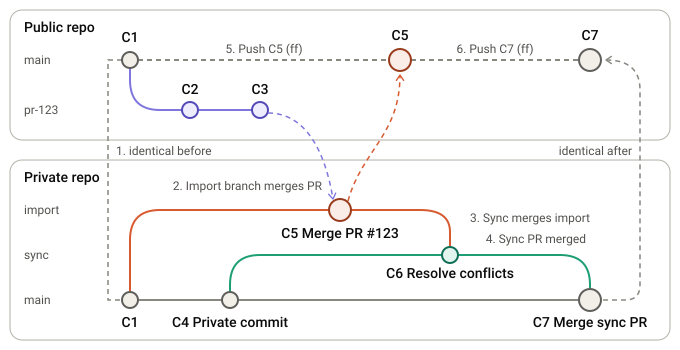

## Integration of external contributions

This section describes how external contributions are integrated into the Torq compiler's
private development repository and then published to the public repository.

Public contributions are pull requests submitted to the `synaptics-torq/torq-compiler`
repository. Maintainers review and test each contribution before integrating it into the
private codebase.

The public repository's `main` branch trails internal development, and public contributors do
not have access to the full internal test infrastructure. Maintainers therefore need to
integrate and test each contribution privately before publishing it.

To preserve the original contribution history and attribution, maintainers use the following
flow. Only one public contribution can be processed at a time:

| Commit | What it is |
|---|---|
| C1 | Shared base; both repositories' `main` branches point here initially |
| C2, C3 | The pull request's commits; C3 is the PR head |
| C4 | A private-only commit on private `main` |
| C5 | Merge commit for PR #123 on the `import` branch |
| C6 | Merge commit on the `sync` branch that resolves conflicts |
| C7 | Merge commit that brings the `sync` branch into private `main` |

1. **Start:** Public and private `main` both point to C1. The PR contains C2 and C3, based on C1.
2. **Import:** Create the `import` branch from public `main` and merge the PR into it as C5. C5 has C1 and C3 as parents.
3. **Sync:** Create the `sync` branch from private `main` at C4, then merge the `import` branch into it. Resolve any conflicts in the merge commit C6.
4. **Private PR:** Merge the `sync` branch into private `main` as C7. Private `main` now includes both the private-only work and the public PR.
5. **First push:** Push C5 to public `main`. Because public `main` is still at C1 and C5 descends from C1, this is a fast-forward. GitHub recognizes the PR as merged because its head, C3, is now an ancestor of public `main`.
6. **Second push:** Push C7 to public `main`. C7 descends from C5 through C6, so this is also a fast-forward, provided public `main` has not advanced since the first push. Both `main` branches then point to C7.

The first push publishes only the PR merge. Although C4, C6, and C7 are already present in private `main`, they are not published until the second push; public `main` remains at C5 between the pushes. No other commit can be pushed to public `main` during this interval, or the second push may no longer be a fast-forward.