# The prefetch list scheduler

How `PrefetchInputsPass` reorders a function's NSS stream so that DMA transfers
overlap slice compute. Everything here follows
`compiler/torq/Codegen/PrefetchInputsPass.cpp`: `StreamGraph`, `simulateOrder`,
`listSchedule` and `PrefetchInputsPass::runOnOperation`.

- [1. The problem](#1-the-problem)
- [2. The hardware model](#2-the-hardware-model)
- [3. Where the pass runs and what it sees](#3-where-the-pass-runs-and-what-it-sees)
- [4. Step 1: the dependency graph (`StreamGraph`)](#4-step-1-the-dependency-graph-streamgraph)
- [5. Step 2: the scheduling loop (`listSchedule`)](#5-step-2-the-scheduling-loop-listschedule)
- [6. Worked example 1: overlap and both slices](#6-worked-example-1-overlap-and-both-slices)
- [7. Worked example 2: the LRAM limits](#7-worked-example-2-the-lram-limits)
- [8. Step 3: choosing a schedule (`runOnOperation`)](#8-step-3-choosing-a-schedule-runonoperation)
- [9. The tile budgets](#9-the-tile-budgets)
- [10. Limits and known gaps](#10-limits-and-known-gaps)
- [11. Flags](#11-flags)

---

## 1. The problem

After lowering, a function is one long in-order **NSS control stream**:

```
load  w1          ; DMA XRAM -> LRAM, blocks the stream
start P1          ; slice runs P1, the stream goes on
wait  P1          ; blocks until P1 is done
load  w2
start P2
wait  P2
...
store out         ; DMA LRAM -> XRAM, blocks the stream
```

Written like this, the DMA engine and the slices take turns: while `P1` computes,
nothing is loading `w2`, and while `w2` loads, both slices are idle. The list
scheduler rewrites the **order** of these operations (and which slice runs each
program) so that loads, stores and compute overlap, without changing what is
computed and without exceeding LRAM.

## 2. The hardware model

```
              NSS stream (in order, one op at a time)
                 |            |             |
                 v            v             v
          +-------------+  +---------+  +---------+
          |  DMA engine |  | slice 0 |  | slice 1 |
          | (loads AND  |  +---------+  +---------+
          |  stores)    |
          +-------------+
                 \            |             /
                  +------- LRAM (512 KB) --+
```

| op | what it does to the stream | time model in the scheduler |
|---|---|---|
| `torq_hl.load` | blocks until the transfer is done | `t = max(t, dmaFree) + dur; dmaFree = t` |
| `torq_hl.store` | blocks until the transfer is done | same as a load: **one** DMA engine for both |
| `start_program` | asynchronous, the stream goes on | slice busy until `t + compute`; `t += 1` |
| `wait_program` | blocks until that program ends | `t = max(t, sliceEnd)` |

The durations come from the IR. Load cycles come from `dmaCyclesForLoad`. Store
cycles come from the `torq-async-duration-cycles` attribute, and compute cycles from
the `slice_profiling` annotations that `AnnotateDmaAndSliceCyclesPass` adds just
before this pass.

The **makespan** is `max(t, dmaFree)` after the last op. `simulateOrder` computes it
for any order with exactly these rules, and that is how the input order is priced.

## 3. Where the pass runs and what it sees

The pass runs only with `--torq-prefetch-algorithm=stream-schedule`. The default,
`auto`, is `constant-loads` (`torq-prefetch-constant-loads`) on every chip, so a
compile without the flag does not change. Only one prefetch algorithm runs in a
compile.

```
TileAndFuse -> ... -> bufferization -> slice programs outlined
  -> ConvertSliceProgramToTorqHw
  -> AnnotateDmaAndSliceCycles        (durations)
  -> PrefetchInputs   <== here (--torq-prefetch-algorithm=stream-schedule)
  -> AddDeallocation -> RecoverLramResidency -> AssignLramAddresses
```

It runs **before** LRAM addresses are assigned. The buffers are still
`memref.alloc`s, so the scheduler is free to reorder. It has to predict whether the
allocator can place the new order, and it checks that by running the real allocator
on a clone (section 8).

## 4. Step 1: the dependency graph (`StreamGraph`)

Every op in the block becomes a node of one of six kinds:

| kind | ops | scheduled? |
|---|---|---|
| `Pure` | `memref.alloc`, constants, views, invocations, program bodies | no: emitted just before the first action that needs it |
| `Load` | `torq_hl.load` | yes, on the DMA engine |
| `Store` | `torq_hl.store` | yes, on the DMA engine |
| `Start` | `start_program` of a slice invocation | yes, on a slice |
| `Wait` | its matching `wait_program` | yes |
| `Barrier` | anything else (host/CSS calls, a start without a wait, ...) | yes, keeps its place |

Edges (`A -> B` means A must come first):

1. **SSA**: B uses a value A defines, including values used inside B's regions.
2. **Program**: `start P -> wait P`.
3. **Barriers**: everything since the previous barrier goes before a barrier, and a
   barrier goes before everything after it.
4. **Memory**: two accesses to overlapping byte ranges of the same buffer, at least
   one of them a write, keep their input order. This covers read-after-write,
   write-after-read and write-after-write, in LRAM and in XRAM. A program holds its
   buffers until its **wait**, so an edge out of a program starts at its wait.

```
   load w1 ---> start P1 ---> wait P1 ---+
                                          |  (P3 reads P1's output o1)
   load w3 -------------------------------+--> start P3 ---> wait P3 ---> store out
   load w2 ---> start P2 ---> wait P2
```

The graph also records, for the LRAM model:

- `allocBytes_`: the size of every LRAM buffer. It is **born** when its alloc is
  emitted, which happens just before its first user.
- `userAllocs_` / `allocUserCount_`: who uses each buffer. It **dies** after its last
  user, and for a program that is the program's **wait**.
- `startBuffers_`: the buffers each program touches. They are used to mark a load as
  "urgent" (section 5).
- `firstConsumer_`: the first program that reads a load's buffer. It is used for the
  "reserve" (section 5).

## 5. Step 2: the scheduling loop (`listSchedule`)

A classic **list scheduler**: keep a set of *ready* actions (all predecessors
already emitted), and at each step pick one ready action and emit it. The policy
plays out the hardware of section 2 on a simulated clock.

### State

| | |
|---|---|
| `t` | current position of the in-order stream, in cycles |
| `dmaFree` | when the DMA engine is free |
| `sliceProg[s]`, `sliceEnd[s]` | program running on slice `s` (or none), and when it ends |
| `live` | LRAM bytes currently alive |
| `space` | an `LramAddressSpace` of `cap` bytes: real offsets, two-ended first fit |
| ready sets | `readyStarts`, `readyDmas` (loads and stores), `readyWaits`, `readyBarriers`, each oldest first |

`LramAddressSpace` mirrors the real allocator's policy. Buffers under 8 KB go
bottom-up and larger ones top-down, so small buffers do not fragment the space the
large ones need. A buffer "fits" only if **every** buffer the action creates gets a
real contiguous range, not just if the byte total is under `cap`.

### One step: the decision order

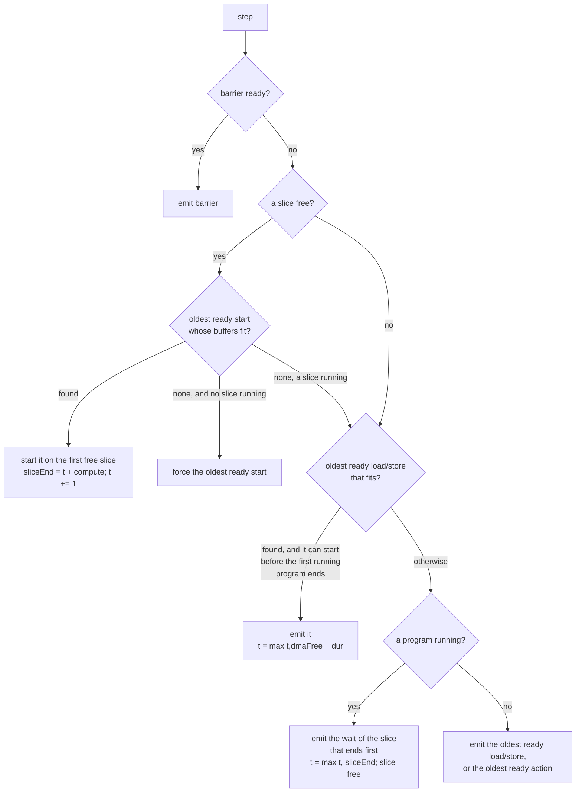

In words:

1. **Barrier** ready: emit it at once.
2. **A slice is free**: take the oldest ready `start` (looking at no more than 32)
   whose new buffers all get an address under `cap`. Put it on the **first free
   slice**. If none fits and no slice is busy, start the oldest one anyway, so the
   schedule cannot deadlock.
3. **The DMA engine**: take the oldest ready load or store (no more than 32 again)
   that fits:
   - a **store** always fits, because it frees memory;
   - a **load** for one of the next `urgentStarts` (4) programs may use all of `cap`;
   - any other load (a *prefetch* for a program further ahead) may only fill LRAM up
     to `prefetchCap` (40% of `cap`);
   - every load also leaves a **reserve**: room for the largest program that starts
     before the load's consumer. The loaded buffer stays alive across those
     programs, so they must still fit next to it.

   Emit the transfer only if it can start **before the first running program ends**
   (`max(t, dmaFree) <= earliestEnd`). Otherwise the stream would sit in a
   transfer while a slice goes idle.
4. **Otherwise wait**: emit the `wait` of the slice that ends first. Its buffers are
   released, and the slice is free.
5. **Nothing applies**: emit the oldest ready load or store, or the oldest ready
   action, so it always makes progress.

Emitting an action also emits, just before it, every pure op it needs that is not
out yet: its allocs, views and invocation. That is where its buffers are **born**
(`append`). Emitting the last user of a buffer releases it from `space`.

The result is the new op order, the slice of every program (`sliceOfStart`, which
becomes the invocation's `executor_id`), the predicted makespan and the peak live
bytes.

## 6. Worked example 1: overlap and both slices

Three programs, plenty of LRAM:

| | needs | compute |
|---|---|---|
| `P1` | weights `w1` (load `L1`, 30 cycles) | 100 |
| `P2` | weights `w2` (load `L2`, 30 cycles), independent of P1 | 100 |
| `P3` | weights `w3` (load `L3`, 30 cycles) and P1's output | 100 |
| `S3` | store of P3's output, 20 cycles | |

**Input order, priced by `simulateOrder`:**

```
L1 start P1 wait P1 L2 start P2 wait P2 L3 start P3 wait P3 S3

t:   0    30        130 160        260  290        390   410
DMA  [L1]           [L2]           [L3]                [S3]
s0       [----P1----]  [----P2----]   [----P3----]
s1       (idle the whole time)
makespan 410
```

**`listSchedule`, step by step.** At the start `L1`, `L2` and `L3` are ready, and no
start is ready.

| step | t before | slices | rule | emits | t after |
|---|---|---|---|---|---|
| 1 | 0 | s0 free, s1 free | 2: no ready start. 3: L1 is urgent and fits, no program running | `L1` | 30 |
| 2 | 30 | both free | 2: P1 ready, fits | `start P1` -> **s0** (ends 130) | 31 |
| 3 | 31 | s1 free | 2: P2 not ready. 3: L2 starts at 31 <= 130 | `L2` | 61 |
| 4 | 61 | s1 free | 2: P2 ready | `start P2` -> **s1** (ends 161) | 62 |
| 5 | 62 | none free | 3: L3 starts at 62 <= 130 | `L3` | 92 |
| 6 | 92 | none free | 3: nothing ready (S3 needs P3). 4: s0 ends first | `wait P1` | 130 |
| 7 | 130 | s0 free | 2: P3 ready (L3 done, P1 done) | `start P3` -> **s0** (ends 230) | 131 |
| 8 | 131 | none free | 4: s1 ends first (161) | `wait P2` | 161 |
| 9 | 161 | s1 free | 2: nothing ready. 4: s0 running | `wait P3` | 230 |
| 10 | 230 | both free | 3: S3 ready, nothing running | `S3` | 250 |

```
new order: L1 start P1 L2 start P2 L3 wait P1 start P3 wait P2 wait P3 S3

t:   0    30 61 92     130            230   250
DMA  [L1][L2][L3]                      [S3]
s0       [-----P1-----][-----P3-----]
s1           [-----P2-----]
makespan 250   (-39%)
```

Two things happened. **L2 and L3 load while P1 computes** (rule 3), and **P2 runs on
slice 1 next to P1** (rule 2, first free slice). The memory edge `wait P1 -> start P3`
still holds, so P3 reads P1's finished output.

### The same example, picture by picture

Each step figure
has five parts:

- **The graph (left):** grey nodes are already emitted, numbered by the step that
  emitted them. Thick outlines are ready, dashed nodes are still waiting on a
  predecessor, and the orange box is the node picked in this step.
- **A. Ready queues:** every ready node sits in the FIFO queue of the resource that
  runs it: starts go to a slice, loads and stores to the DMA engine, and waits block
  the stream. Each queue is oldest first, by input order. Under the queues: which node
  leaves (the one emitted), and which nodes join because the emitted node was their
  last missing predecessor.
- **B. Decision:** the five rules of section 5, checked top to bottom. The first rule
  that applies picks the node from the head of its queue. Every rule above it is
  marked *skip* with the reason, and every rule below is *not reached*.
- **Simulated hardware:** the DMA engine and both slices, up to the current clock
  (orange line).
- **The new order** built so far.

**Where does it start?** At the **top** of the graph. The scheduler walks forward in
time, not backwards from the result. At `t = 0` the only ready nodes are the
*sources*, the nodes with no predecessors: here the three loads. A node becomes ready
the moment its last predecessor is emitted. Among ready nodes, the rules of section 5
decide, and ties go to the oldest one in the input order.

**Step 0: the IR becomes a graph.** Each NSS op is a node. Its kind decides which
resource runs it (DMA engine or slice). Edges are the orderings that must be kept.

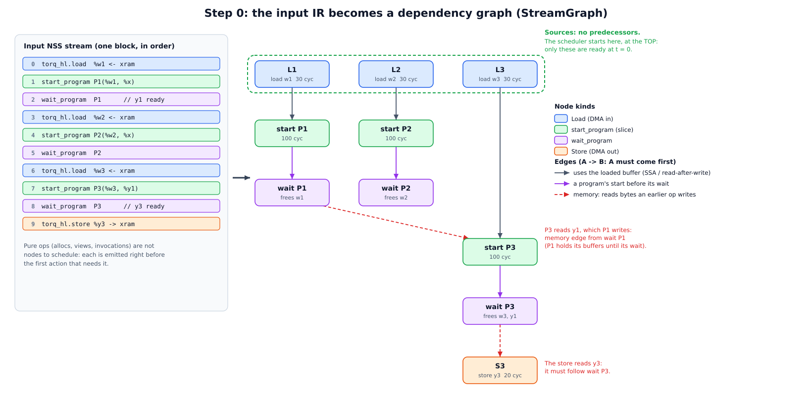

**Step 1:** no program is ready yet, so the DMA engine takes the oldest ready load.

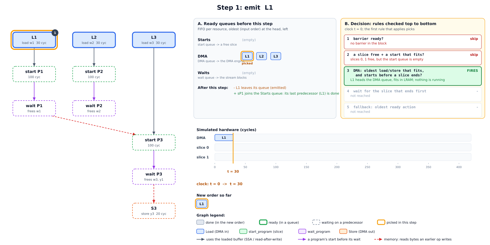

**Step 2:** P1's input is in, so P1 starts on the first free slice, slice 0. `start`
does not block, and the stream moves on at `t + 1`.

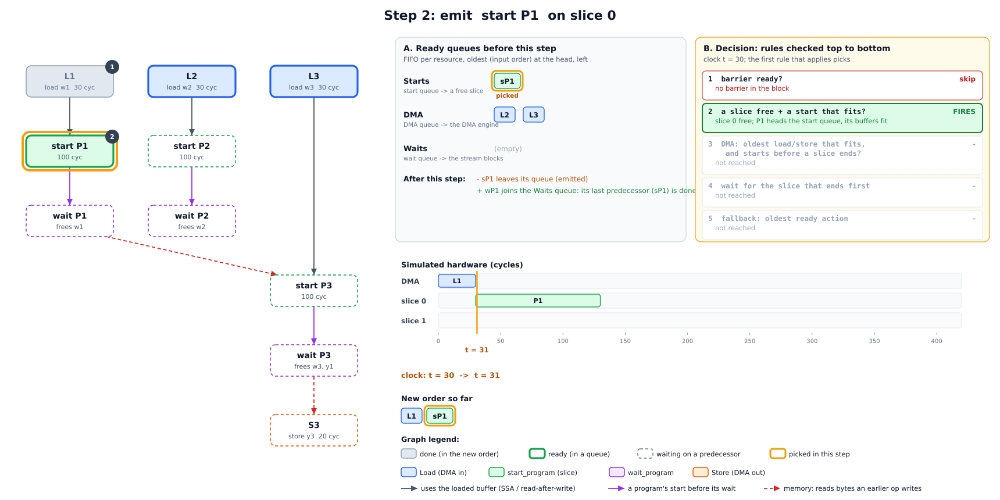

**Step 3:** P2 is not ready, but L2 can start before P1 ends. This is the overlap:
w2 loads while P1 computes.

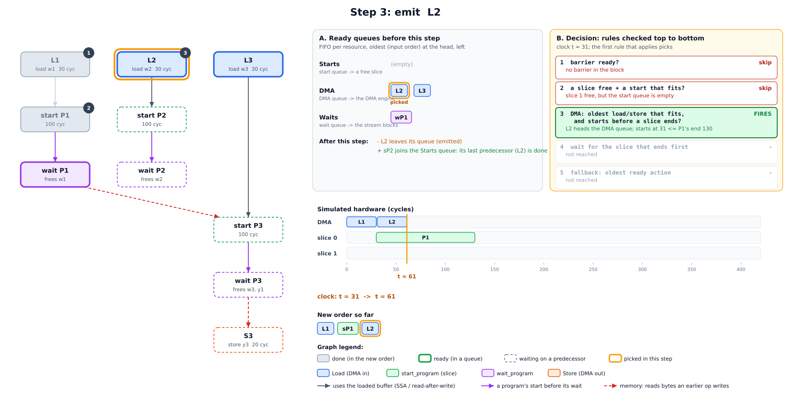

**Step 4:** P2 is ready and slice 1 is free, so both slices now compute.

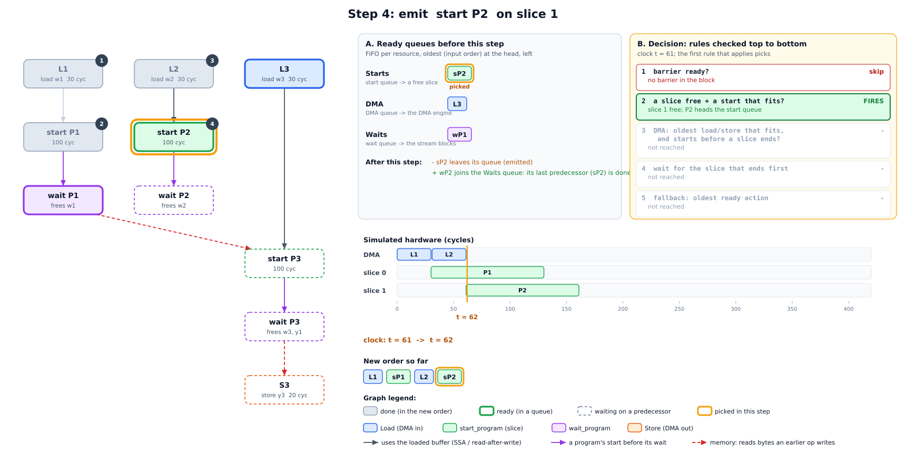

**Step 5:** no slice is free, and L3 still starts before the first program ends: w3
is prefetched for P3.

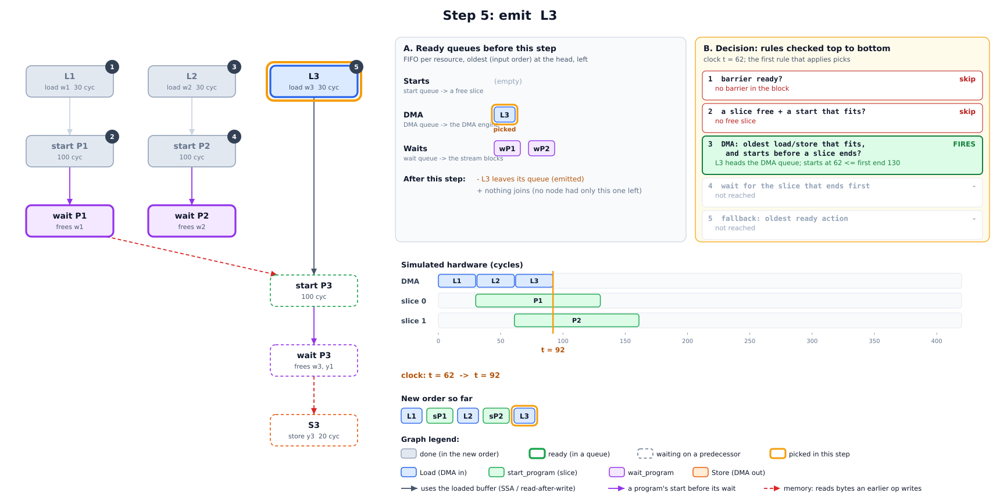

**Step 6:** nothing useful is left for the DMA engine, so the stream waits for the
slice that finishes first (P1). That frees slice 0 and P1's buffers.

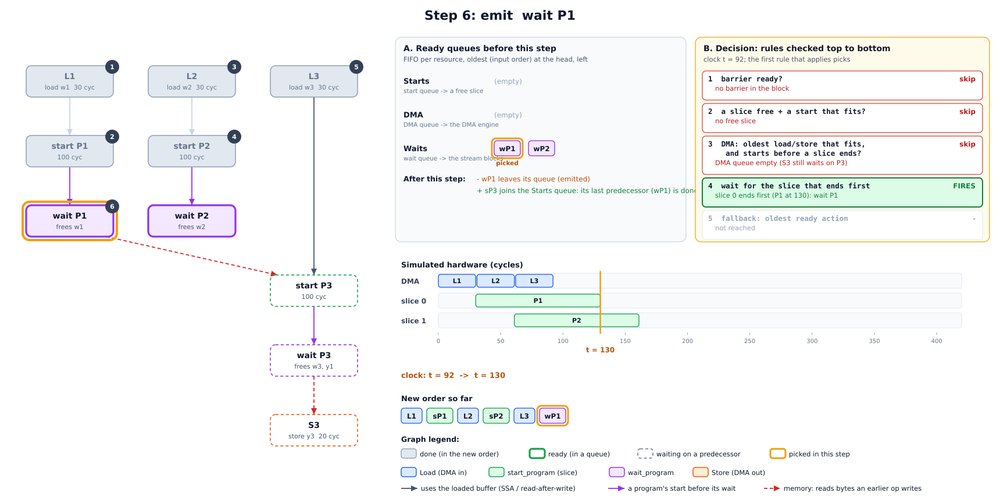

**Step 7:** P3 is ready only now: its weights are loaded and P1's output is final.
It goes on slice 0.

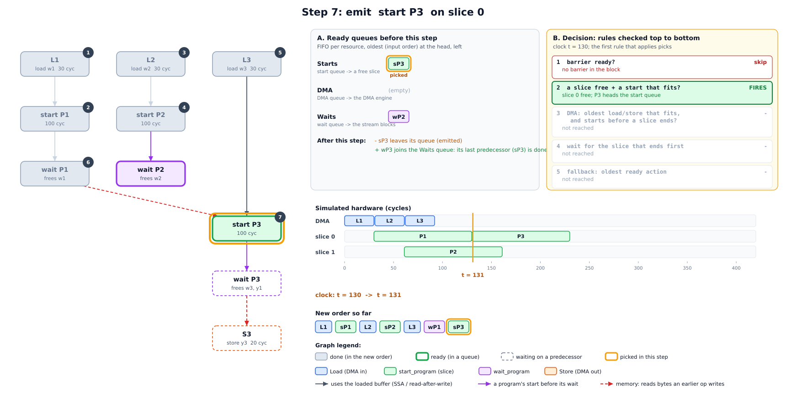

**Steps 8 to 10:** wait for P2, then P3, then store P3's output.

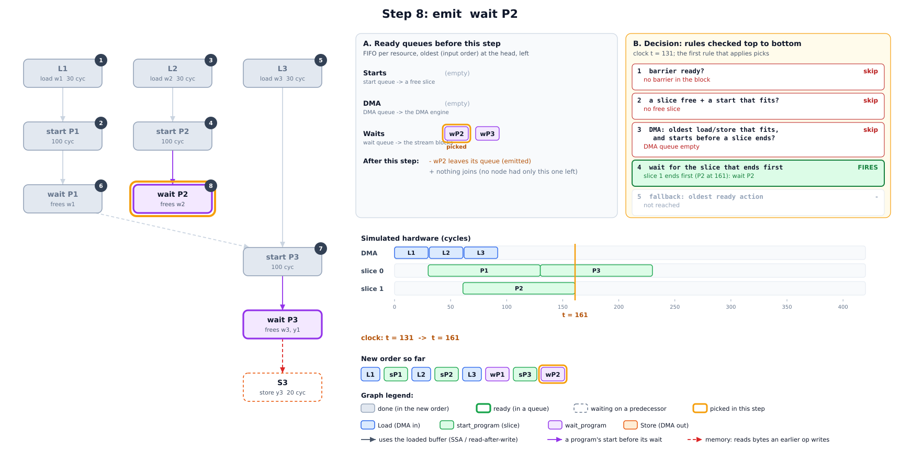
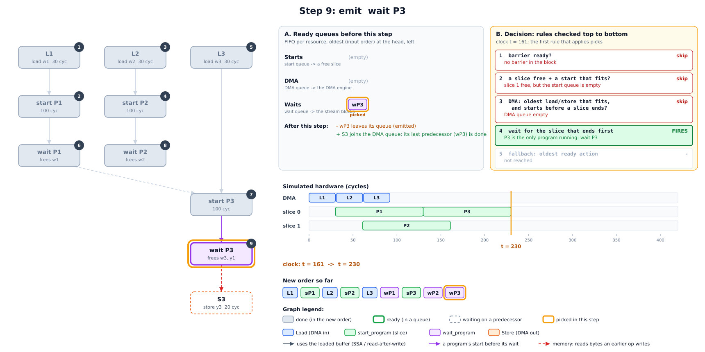
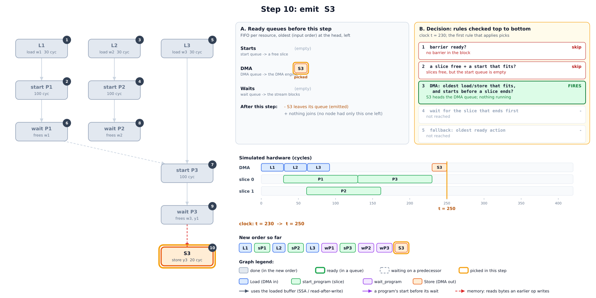

**Result:**

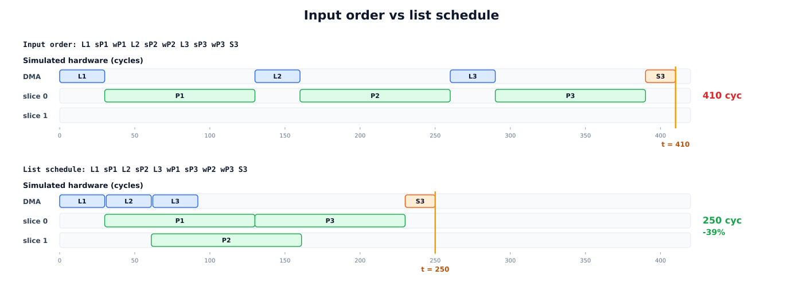

## 7. Worked example 2: the LRAM limits

The same rules decide **how far ahead** a load may go. Take `cap = 100 KB`, so
`prefetchCap = 40 KB`. Use `urgentStarts = 1` to keep it short (the real default is 4).
Five programs follow each other. Each needs one 30 KB weight buffer and writes one
30 KB output, and P1 is running with 30 KB live.

| load | for | urgent? | limit | live + load + reserve | decision |
|---|---|---|---|---|---|
| L2 | P2 (next) | yes | 100 KB | 30 + 30 + 0 = 60 | emit |
| L3 | P3 | no | 40 KB | 60 + 30 + 30 = 120 > 40 | **wait** |

The reserve for L3 is P2's 30 KB output. P2 starts before L3's consumer P3, and that
buffer is born when P2 starts. P2's weights do not count: L2 already brought them
in.

L3 is held back. It is a prefetch for a program two steps away, and LRAM is already
over the prefetch cap. Once `wait P1` frees P1's weights and P2 starts, P3 becomes
the next program, so L3 is urgent and may use the full `cap`.

Without these limits the scheduler would greedily load weights for programs far
ahead and fill LRAM. The near programs would then not fit, and the allocator would
have to insert swaps (spill and reload DMA), which costs more than the overlap gains.

## 8. Step 3: choosing a schedule (`runOnOperation`)

`listSchedule` only *predicts*. The pass then asks the **real allocator** (on a
clone) what the order costs:

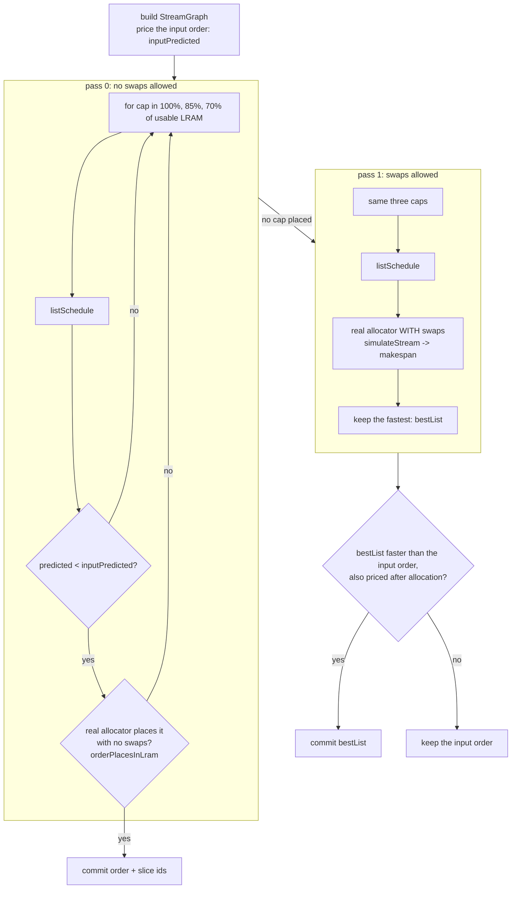

- **Pass 0** wants a schedule the allocator places without a single swap. A smaller
  `cap` leaves the allocator slack the model cannot see: alignment, fragmentation,
  NSS program slots. On most functions the first cap places, and the pass stops there.
- **Pass 1** runs only when no cap placed. It asks whether a schedule still beats the
  input order when the allocator's swaps are included. Each candidate is priced
  *after* allocation, its swaps included, and the fastest is kept. This occurs mostly
  when the **input order itself** needs more LRAM than exists, so the allocator swaps
  whatever the order. A schedule with a few swaps can also beat an input order that
  places without swaps, when its overlap gains more than the swaps cost.
- A schedule must beat the input order. The prediction cannot see swaps, so it is the
  bar only when the input order places without them. When the input order needs swaps,
  the bar is its real cost after allocation.
- If no schedule beats the input order after allocation, the input order is kept, so the
  pass never makes a block slower by its own measure.

Every attempt runs the real allocator on a clone, so a block pays at most 3
allocator runs in pass 0, plus 3 more in pass 1.

## 9. The tile budgets

The scheduler can load a weight early only when LRAM has free space for it. TileAndFuse
normally sizes every tile against the whole LRAM, so a tile that fills LRAM leaves no
space for the next load. With `stream-schedule`, TileAndFuse sizes some tiles against a
smaller part of LRAM, the **tile budget**. Only the tile-fit probe sees the smaller
budget. The real pipeline still allocates into the whole LRAM, so the free space is there
for the scheduler.

TileAndFuse first looks at the whole function:

| function | budgets |
|---|---|
| constants fit in LRAM | the whole LRAM for every loop, as without the flag. The weights load one time and stay, so there is nothing to stream. |
| constants > LRAM | every loop gets `--torq-prefetch-tile-budget-percent` (default 50), except the matmul loops, which get `--torq-prefetch-matmul-tile-budget-percent` (default 40). FoldConvert sizes against `--torq-prefetch-tile-budget-percent`, because the probe and the real pipeline must keep the same data in LRAM. |

- **A matmul loop** is a tile loop rooted at a contraction (a matmul). The
  smaller tile costs it no halo, and the next weight tile loads while the current tile
  computes. A 52 MB int4 LM head (one matmul) goes from 25.9 ms to 13.7 ms on the board.
- **The matmul tile must not split the rows.** The rows are the parallel dimensions the
  weight does not index. If the smaller budget splits them, each row tile loads the whole
  weight again (matmul 1x128x768x3072 bf16: 2 x 64 rows load a 4.7 MB weight two times,
  +91%). Then the loop fits against the whole LRAM.
- **All the loops of the function.** The free LRAM lets the next layer's
  weights load while the current layer computes. gemma3 hybrid: 61.0 ms with the smaller
  budget on the matmul loops only, 54.9 ms with it on all the loops.
- **Convolution models are not tuned yet.** A convolution pays for a smaller tile with
  halo reloads and recompute, so a convolution model can be slower with
  `stream-schedule`. Do not use it for convolution models yet.

## 10. Limits and known gaps

- **No swaps in the model.** The scheduler assumes everything it schedules stays in
  LRAM. When the input order itself is over LRAM, pass 0 cannot place, and on some
  models the schedule is predicted slower than the input order and is dropped. This
  occurs on convolution models whose tiles fill LRAM (section 9).
- **FIFO policy.** "Oldest ready first" is simple and keeps the order close to the
  input, but it is not critical-path aware. A long chain is not started earlier than
  its position says.
- **First free slice.** No load balancing: a program goes to whichever slice is free
  first. Splitting one op across both slices is LinalgSlicing's job, earlier in the
  pipeline.
- **32 candidates per step.** This bounds compile time on large functions, where
  thousands of weight loads are ready from the start.
- **Predicted vs real.** The DMA and compute cycles are estimates (the same ones the
  compile-time profile uses), so a predicted gain is checked against the real
  allocator, never trusted on its own.

## 11. Flags

All flags apply only with `--torq-prefetch-algorithm=stream-schedule`, except the
algorithm flag itself.

| flag | default | meaning |
|---|---|---|
| `--torq-prefetch-algorithm` | `auto` | `stream-schedule` (this pass and the tile budgets of section 9), `constant-loads` (`torq-prefetch-constant-loads`), or `none`. `auto` is `constant-loads` |
| `--torq-prefetch-tile-budget-percent` | 50 | percent of LRAM the tile-fit probe may use in a function whose constants do not fit in LRAM. FoldConvert uses it too (section 9) |
| `--torq-prefetch-matmul-tile-budget-percent` | 40 | percent of LRAM for a matmul tile loop in a function whose constants do not fit in LRAM (section 9) |
| `--torq-list-cap-percent` | 100 | first cap, in % of usable LRAM (then x0.85 and x0.70) |
| `--torq-list-prefetch-percent` | 40 | `prefetchCap`, in % of `cap`, for loads of far programs |
| `--torq-list-urgent-starts` | 4 | how many upcoming programs count as near |
