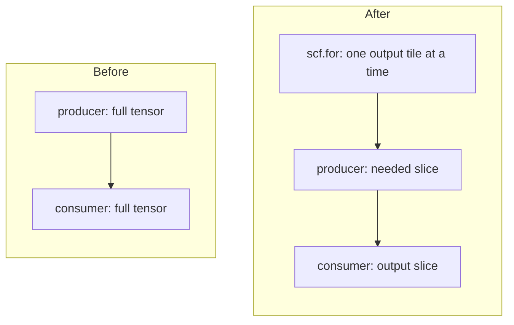
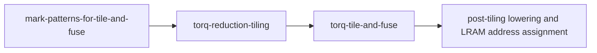
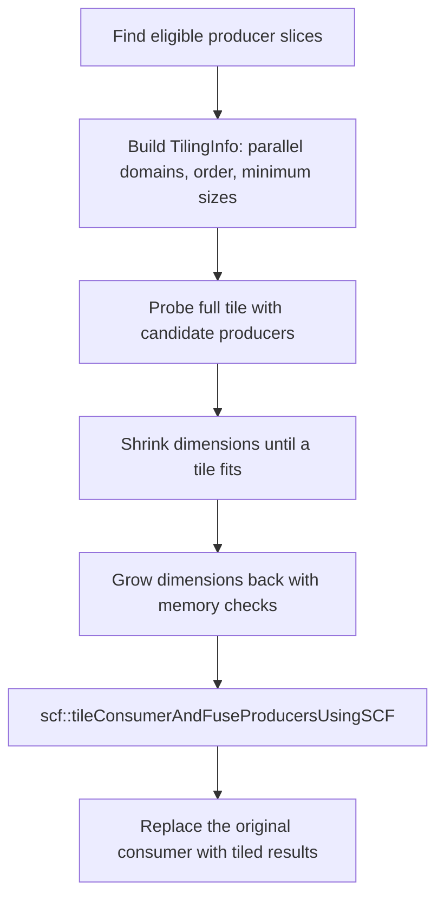
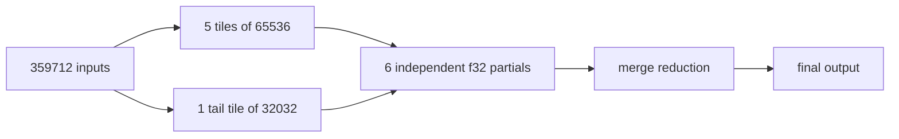

# Tile and fuse, and reduction tiling

Tile-and-fuse makes an operation fit in the neural processing unit's (NPU's) local RAM (LRAM) by computing its output in smaller pieces. It may also move the computations that produce each piece's inputs into the same loop. This guide describes that transformation, the preparatory reduction pass, and how their tile sizes are chosen.

## The basic transformation

A **consumer** is the operation whose output needs tiling. A **producer** computes a value the consumer uses. A **tile** is a slice of an operation's iteration space, such as 32 output rows of a matmul. **Fusion** computes a producer's corresponding slice inside the consumer's tile loop, instead of materializing the producer's full tensor first. MLIR's `TilingInterface` defines how each involved operation computes a tile; `scf.for` is the loop operation used to run those tiles.



For example, consider this matrix multiplication: `%a` and `%w` are function inputs; `%z` initializes the matmul result. The `torq-fuse-group` attributes mark operations that must tile together; their IDs are explained under Fuse groups. The tensors use `bf16` (bfloat16) elements.

```mlir
%z = linalg.fill {"torq-fuse-group" = [1], "torq-fuse-group-id" = 0 : i64}
    ins(%zero : bf16) outs(%e : tensor<300x3200xbf16>) -> tensor<300x3200xbf16>
%r = linalg.matmul {"torq-fuse-group" = [1], "torq-fuse-group-id" = 1 : i64}
    ins(%a, %w : tensor<300x800xbf16>, tensor<800x3200xbf16>)
    outs(%z : tensor<300x3200xbf16>) -> tensor<300x3200xbf16>
```

If the full result does not fit, tile-and-fuse can choose output row and column tiles. The following is a sketch of the result:

```mlir
scf.for %m = %c0 to %c300 step %tile_m {
  scf.for %n = %c0 to %c3200 step %tile_n {
    %a_tile = tensor.extract_slice %a[%m, 0] ...
    %w_tile = tensor.extract_slice %w[0, %n] ...
    %empty_tile = tensor.empty(%size_m, %size_n) : tensor<?x?xbf16>
    %zero_tile = linalg.fill ins(%zero : bf16) outs(%empty_tile : tensor<?x?xbf16>)
    %result_tile = linalg.matmul ins(%a_tile, %w_tile) outs(%zero_tile)
    // Insert this result into the full output tensor.
  }
}
```

The output's parallel dimensions (`m` and `n`) become tile loops. The matmul's reduction dimension (`k`) stays whole in this example. Fusion of `%z` means the fill can initialize each output tile where it is used. The exact tile sizes and producer choices come from the memory probe described below.

## Where the passes sit

The tile-and-fuse passes are arranged in the following order:



* The marking pass records which operations must stay together for later Linalg-to-TorqHL patterns.
* The reduction pass handles NPU Sub System (NSS) reduction descriptor and LRAM constraints on eligible `linalg.generic` reductions.
* Tile-and-fuse then tiles remaining work over parallel dimensions and fuses eligible producers.

:::{note}
Both passes create `scf` loops when tiling but they choose tiles for different reasons and use different memory checks.
:::

## Fuse groups

Some Linalg-to-TorqHL patterns need a chain of operations lowered together in one tile. The marking pass records such chains without lowering them. It first gives every `TilingInterface` operation a unique ID (`torq-fuse-group-id`), then runs the Linalg-to-TorqHL patterns in a marking mode. A matched pattern takes the unique ID of the operation where matching started as the group ID, and `markFuseGroupBackward` adds that ID to a `torq-fuse-group` array attribute on every operation between the pattern's output and its inputs. The member whose unique ID equals the group ID is the group's **principal**. The array form lets one operation belong to several groups.

The matmul example above was marked this way: the fill got unique ID `0`, the matmul unique ID `1`, and the matmul pattern matched with the matmul as the anchor. Group `1` therefore contains both operations, and the matmul is its principal. The matmul is also the group's **output** (the member with no user in the same group, found by `isFuseGroupOutput`), while the fill is not, because its only user, the matmul, is in the group.

Tile-and-fuse treats a marked chain as a unit. It tiles from the group's output, and its fusion control functions treat eligible marked members on the producer side as required, before checking whether optional producers fit. A middle member is therefore never queued for tiling on its own. To find the principal, `getFuseGroupPrincipalOpBackward` walks backward from the group output through marked operands, stopping at function and loop arguments, which have no defining operation. In the example the walk is trivial, since the output and the principal are the same operation.

The reduction tiling pass may move a marked principal reduction into a new `scf.for`. A backward walk from a later group output then reaches the loop result instead of the principal and returns null. Tile-and-fuse accepts that and uses the current operation for tile-size policy. That is safe: only convolution and pooling principals get special minimum tile sizes, and an unreachable principal is a generic reduction.

## How tile-and-fuse chooses work

`TileAndFusePass.cpp` walks `TilingInterface` operations in reverse order of appearance (users before their producers), so a producer that is fused into a user's tile is never separately tiled afterward. An operation is queued for tiling only if it passes all of the following:

* it is not assigned to the Host executor: Host operations do not run on the NPU, so LRAM fit is meaningless for them;
* it is not inside a `torq-reduction-tiling-loop`: the reduction tiling pass has already chosen those tiles, and the memory probe below extracts loop-free IR, which would lose the values an operation captures from outside its loop;
* it is not a non-output member of a fuse group: the group is tiled from its output, and the member is fused into that tile (see Fuse groups);
* the full-size memory probe finds that it does not fit.

In the matmul example, the walk visits the matmul first, and if its full tile does not fit, queues it; the fill is filtered out as a non-output group member and instead fused into the matmul's tile.

For a queued consumer that needs tiling, the main path is:



### Tile shape policies

The main tile-and-fuse search tiles only parallel dimensions: shrinking a reduction dimension changes the accumulation, which the preparatory reduction pass handles (see Why reductions have a preparatory pass). `TilingInfo` collects the inputs to that search: the parallel domains in tiling order, a minimum size per domain, and per-domain size adjustments. The minimum sizes reserve two hardware requirements:

* **Slicing granularity.** The post-tiling LinalgSlicing pass distributes conv2d, depthwise conv2d, and max pooling (NHWC and NCHW variants) across NPU slices along the output channel dimension, in groups of 4 channels. When slicing is enabled, tile-and-fuse therefore reserves at least `4 * sliceCount` channels on that dimension, so that every slice receives at least one group. These convolutions and pooling operations are currently the only ones with a slicing-derived minimum.
* **Sub-byte alignment.** When an operand in the tile group is packed sub-byte (e.g. an i4 weight), direct memory access (DMA) can address only whole bytes. Packing runs along the innermost (contiguous) axis, so the innermost tiled dimension must be a multiple of the values per byte (2 for i4); the outer dimensions step whole rows and are aligned for any tile size.

The minimums are **best effort**: if the group still does not fit with every dimension at its minimum, the search falls back to the smallest valid tile. Each shrink step runs the full memory probe. The shrink order can affect both the chosen tile shape and the number of probes. The pass uses operand sizes to prioritize some dimensions; for the example matmul, it tries N first because shrinking N to 1 reduces the 5,120,000-byte weight to a 1,600-byte slice and shrinks the output, while shrinking M to 1 leaves the weight unchanged and reduces the 480,000-byte activation to a 1,600-byte slice.

Loop order changes DMA traffic without changing the tile: the inner loop's operand is streamed again for each outer tile unless the full operand fits LRAM. The pass therefore estimates traffic for `for(m){for(n)}` and `for(n){for(m)}` and swaps the loops when the latter is strictly cheaper. In the example, if both dimensions are tiled, the 480,000-byte activation fits the LRAM budget while the 5,120,000-byte weight does not, so the estimate favors `for(n){for(m)}` to avoid repeatedly streaming the weight.

### The memory probe

A tile's LRAM use depends on the lowering and buffer layout, so tile-and-fuse does not rely only on tensor element counts. `extractOpsForMemoryCheck` clones the consumer, selected producers, and required fuse-group members into a temporary module. `tileModuleForMemoryCheck` tiles that clone symbolically. Each candidate size is substituted into a fresh clone, which runs the post-tiling pipeline through LRAM address assignment. Expected LRAM overflow means the candidate is too large; another pipeline failure is a probe error.

For loops with at least three iterations, the probe pipeline retains a representative **middle** iteration before lowering. It keeps loops with one or two iterations so their boundary tiles are checked. The probe also uses a conservative memory budget and omits a later LRAM recovery that costs DMA. Consequently, a tile rejected by the probe can still fit in the real pipeline. If even the smallest probed tile is rejected, `NoFit` keeps that minimum tile for the real pipeline to decide; it is not itself a compiler error.

The size search starts from the full parallel domain. It first shrinks dimensions to their minimum valid sizes until the probe accepts a tile, then grows shrunk dimensions back using a binary search for the largest fitting sizes. For `max-producers`, producer discovery happens before this search. If the consumer and optional producers do not fit together, the pass retries while retaining only producers required by pattern fuse groups.

| Producer mode | Effect |
| --- | --- |
| `max-producers` (default) | Discover eligible producers at a small tile, then find a size that accommodates them. If necessary, retry with only pattern producers. |
| `max-size` | Choose the consumer tile size first and fuse an eligible producer only when its slice also fits. |
| `only-patterns` | Fuse only producers required by a shared pattern fuse group. |

Set these with `--torq-tile-and-fuse-producers-fuse-mode`. The `internal-max-size-all-domains` value is a producer-discovery step used by `max-producers`, not a separate user policy. Fusion also respects executor assignments, supported producer slices, and other safety checks in the control functions.

## Why reductions have a preparatory pass

A `linalg.generic` reduction has **parallel** dimensions that identify independent output elements and **reduction** dimensions whose values combine into each output. For a `[N, K] -> [N]` sum, `N` is parallel and `K` is a reduction dimension. Shrinking `N` makes fewer outputs per tile; shrinking `K` changes the accumulation and requires combining partial results.

This abbreviated `linalg.generic` has one loop of each kind. Its input map uses both loops, while its output map drops `k` because each `n` produces one sum.

```mlir
%sum = linalg.generic {
    indexing_maps = [affine_map<(n, k) -> (n, k)>, affine_map<(n, k) -> (n)>],
    iterator_types = ["parallel", "reduction"]
  } ins(%input : tensor<2x100000xbf16>) outs(%init : tensor<2xf32>) {
^bb0(%value: bf16, %acc: f32):
  %wide = arith.extf %value : bf16 to f32
  %next = arith.addf %wide, %acc : f32
  linalg.yield %next : f32
} -> tensor<2xf32>
```

NSS imposes two constraints that a normal tile-and-fuse probe does not fully cover:

1. A reduction tile's reduce-write descriptor encodes at most `1 << 16` (65,536) elements.
2. An input or kept output extent can exceed LRAM. The tile-and-fuse allocator probe can treat a reduction input as streamable, even when the NSS reduction needs a kept extent resident in LRAM.

`torq-reduction-tiling` uses the shared operand-byte estimator and LRAM budget to select tiles _before_ tile-and-fuse. The budget is the target's LRAM size minus 14 KiB of descriptor headroom, for example 509,952 bytes on hardware with 512 KiB of LRAM. It currently only considers non-Host `linalg.generic` operations that meet the following criteria:

* one reduction dimension;
* a reduction length greater than one;
* static loop ranges and operand shapes.

If both the full estimated operands fit the LRAM budget and the reduce-write descriptor is legal, it leaves the operation alone.

A short reduction can still need tiling. Consider reducing `bf16[1,640,3,608]` over the size-3 axis. Its input alone is 2,334,720 bytes, and its `[1,640,608]` output is 778,240 bytes, both above the budget. Reducing the size-3 axis further cannot make the kept output fit; the pass must split parallel dimensions while keeping the reduction whole.

Conversely, the `[2,100000] -> [2]` reduction above has 400,000 input bytes and an 8-byte f32 output, below the budget. Its reduce-write descriptor length still exceeds 65,536, so it needs a reduction split.

The NSS descriptor also has secondary loop dimensions (SDIMs); each carries a count of at most `kMaxFactor`, currently defined to be 32,767. A length is **SDIM-friendly** when it fits one SDIM (at most `kMaxFactor`) or factors into two counts of at most `kMaxFactor` each, which run as two nested SDIMs. A length that factors neither way, such as a prime above `kMaxFactor`, cannot be encoded as one descriptor count and must be split into smaller tiles.

The selector begins with the largest reduction tile that is both descriptor-legal and SDIM-friendly; because the constraint applies to the common chunk and the tail alike, SDIM-friendly sizing may leave a smaller tile than the 65,536-element limit alone would allow. It shrinks that tile if necessary, then tries shrinking kept parallel dimensions when reduction-only tiling cannot fit.

### What a split reduction computes

When the reduction dimension is split, the pass asks MLIR's `scf::tileUsingSCF` for `PartialReductionOuterParallel`. Each reduction tile writes an independent partial result, and a final reduction merges those partials. The name refers to independent partial slots; Torq still executes the LRAM tile loops sequentially.



The test case `tests/testdata/torch_ops/reducemean-tiling.mlir` exercises that length. The tail contributes one more partial; it is not a separate continuation of a loop-carried accumulator. This matters for correctness when the length does not divide evenly. If only a parallel dimension is tiled, the reduction remains whole and the ordinary full-reduction tiling path is used.

### Keepdims output maps

A **projected permutation** is an indexing map in which each result is a distinct iteration dimension; constants and repeated or compound expressions are excluded. A reduction preserving the reduced output dimension ("keepdims") may use an output map such as `(d0,d1,d2) -> (d0,d1,0)`: the final output dimension has size one, so this map is not a projected permutation. MLIR's Linalg tiling interface requires the output map of a tiled result to have that form. For a marked fuse-group member that needs tiling, Torq rewrites the reduction to output `(d0,d1)`, then uses `tensor.expand_shape` to restore the unit dimension. For narrow floating-point results such as bf16, that helper also accumulates in f32 before converting back to the original result type. Fuse-group attributes are carried onto the replacement operations.

`torq-reduction-tiling` rewrites a marked keepdims member only after deciding that the reduction needs a tile. Later, tile-and-fuse rewrites remaining group members only when their group does not fit its memory probe. These guards avoid changing the accumulation of operations that need no tiling. Splitting a reduction reorders its summands because each chunk is accumulated separately and then merged; for narrow types such as bf16, the rewrite uses an f32 accumulator to limit precision loss.

Splitting a reduction also requires its output map to be a projected permutation: the current LLVM checkout assumes every result of the partial map is an iteration dimension. A keepdims reduction outside a fuse group is not rewritten, so `torq-reduction-tiling` cannot tile it through the Linalg interface when its output map contains a constant, whether it needs a reduction or a parallel split. An operation that needs neither split is left alone.

### Interaction with tile-and-fuse

The reduction pass tags the loops it creates with `torq-reduction-tiling-loop`. Tile-and-fuse skips operations inside those loops: the preparatory pass has already chosen their tiles, and its memory probe expects loop-free extracted work. Operations outside the marked loops, including a remaining fuse-group output, can still be considered by tile-and-fuse. Producers are not automatically fused into the reduction loop by `tileUsingSCF`.

Current limits are static shapes, one reduction dimension per supported generic, and a projected destination map for split reductions. MLIR's partial-reduction tiling cannot currently split parallel and reduction dimensions in the same `tileUsingSCF` transformation; a reduction that requires both kinds of split may fail rather than compile. The reduction pass reports that failure instead of silently leaving an NSS constraint unsatisfied.

## Code map

| Question | Entry point |
| --- | --- |
| Where are the passes ordered? | compiler/torq/Codegen/TORQLowerExecutableTargetPass.cpp: `addSlicePassesWithTileAndFuse` |
| Which reductions qualify, and how are their tiles chosen? | compiler/torq/Codegen/ReductionTilingPass.cpp: `getSupportedReductionDimAndSize`, `chooseTileSizes`, `tileReduction` |
| How are group members recognized? | compiler/torq/Conversions/LinalgToTorqHL/PatternUtils.cpp: `markFuseGroupBackward`, `isFuseGroupOutput`, `getFuseGroupPrincipalOpBackward` |
| How does the main pass queue, probe, and tile? | compiler/torq/Codegen/TileAndFusePass.cpp: `runOnOperation`, `fitTileToMemory`, `tileAndFuse` |
| Where are the shared budget and reduction tile helpers? | compiler/torq/Codegen/TileAndFuseUtils.cpp: `estimateTiledOperandBytes`, `getLramTilingBudget`, `largestReductionTileAtMost` |
